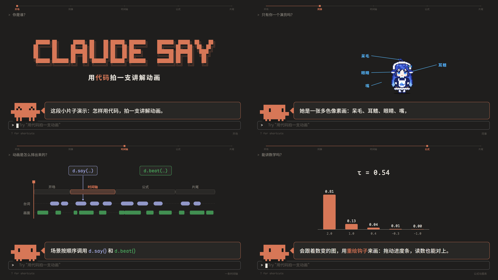
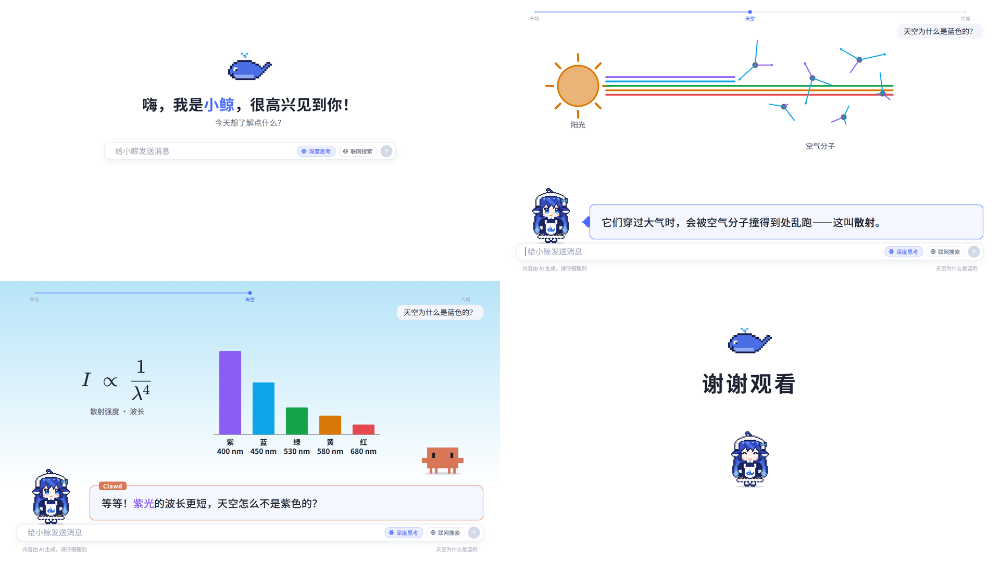

# ClaudeSay Framework

<div align="center">


**用纯代码拍讲解动画的框架**
像素小人当讲解员：台词、画面、配乐、导出全部由代码完成。两个系列——
**Claude 系列**（Claude Code 的橙色像素小人 **Clawd**、深色终端，讲进阶知识）和
**DS 系列**（DeepSeek 的拟人形象 **小鲸**、亮色对话页，讲科普百科）。

</div>

从《Transformer 的前世今生》（[claude-say-transformer](https://github.com/Sparrived/claude-say-transformer)）和 MixA 论文精读（ClaudeSayPaper）
两期视频里抽出来的通用部分：导演时间轴、像素演员（Clawd、小鲸，可以同台对话）、两种外壳（终端 / 对话页）和各自的片头片尾、
公式 / 热力图 / 坐标图、Web Audio 配乐、并行逐帧导出、封面。开新的一期只需要一条命令，然后专心写台词和画面。

---

## 开一期新片

```bash
npm install                 # 第一次用框架时
npm run new -- ClaudeSayResNet --title "ResNet 为什么要走捷径" --slug clawd-resnet     # Claude 系列
npm run new -- WhaleSayRainbow --theme deepseek --title "彩虹是怎么来的"                # DS 系列
```

在框架旁边生成 `../ClaudeSayResNet`：引擎、脚本、这个系列的一支可以直接播放的示例片都在里面，依赖也装好了。接下来：

1. 改 `src/video/config.ts`：片名、导出文件名、进度标尺、配乐编排、封面文字；
2. 把 `src/video/scenes/` 里的示例章节换成自己的；
3. `npm run dev` 边写边看，`npm run render` 导出成片，`npm run cover` 导出封面。

写法、API、规矩和踩过的坑都在 **[GUIDE.md](GUIDE.md)**。

> **引擎是起点，不是终点。** 框架只省掉每期都要重搭的部分，不规定一期视频该长什么样：
> 每一期都应该为题目专门设计画面，引擎里没有的就自己做；做出来的通用零件再还给框架，让引擎越用越丰富（[GUIDE.md](GUIDE.md) 第 0 节）。

## 示例片

框架自带两支示例片，把框架的功能都用了一遍，也是两个系列新项目的起点（同时是引擎的回归测试）。

**Claude 系列**（`src/video/`，约 110 秒）



| 章节 | 演示的功能 |
| :--- | :--- |
| 开场 | 系列片头 `opening()`（敲下 claude、欢迎框、Clawd 跳出来）、片名卡 `titleCard()` |
| 同事 | 小鲸来串门：客串演员 `d.actor()`、`d.say(…, { by })` 换人说话（气泡换色 + 名牌）、多色像素画的部件（呆毛、耳鳍、眼睛、嘴）、两个演员同台 |
| 一条时间轴 | 章节大字、`d.say()` 的逐词对时 `w('…')`、词块 / 箭头 / 数字滚动 |
| 公式与图表 | 论文首页 + 荧光笔、KaTeX 公式分段高亮、真算出来的热力图、D3 坐标图 + 一笔画出的曲线、重绘钩子（拖进度条也能还原的实时读数）、Canvas 画布 `d.canvas()`（追光 `beam` 里飘着尘埃 `motes`） |
| 开新的一期 | 终端面板、逐字打出命令、系列片尾 `ending()` |

**DS 系列**（`src/video-deepseek/`，约 65 秒）



| 章节 | 演示的功能 |
| :--- | :--- |
| 开场 | 对话页片头 `chatOpening()`（首页、鲸鱼图标、提问、深度思考、小鲸从图标里蹦出来）、片名卡 |
| 天空为什么是蓝的 | 一节小科普：亮色主题下的图形 / 公式 / 柱状图、Canvas 光效（太阳的光晕 `halo`、满天的蓝点 `motes`）；Clawd 跳进来追问，小鲸回答 |
| 下期见 | 对话页片尾 `chatEnding()`（发一句谢谢，回到首页） |

```bash
npm run dev                     # http://localhost:5170（Claude 系列）
npm run render                  # → out/clawd-demo.mp4
DEMO=deepseek npm run dev       # DS 系列（PowerShell：$env:DEMO='deepseek'; npm run dev）
DEMO=deepseek npm run render    # → out/whale-demo.mp4
```

播放器快捷键：`空格` 播放/暂停，`←/→` 切换章节，`Shift + ←/→` 快退/快进 5 秒，`M` 静音，`F` 全屏。

## 结构

```
src/
├── engine/          引擎：所有片子共用（导演、演员 Clawd / 小鲸、主题、外壳：终端 / 对话页、气泡、配乐、播放器、成套画面、可视化工具箱）
├── video/           这一期的内容：config.ts + scenes/（框架里是 Claude 系列的示例片）
├── video-deepseek/  DS 系列的示例片（只在框架里有）
├── main.ts          入口：boot(VIDEO, SCENES)
└── cover.ts         封面入口
scripts/
├── new.mjs          开新片（只在框架里有）
├── engine.mjs       视频项目和框架之间同步引擎：status / diff / pull / push（开 PR 等人工审阅） / pr
├── render.mjs       并行逐帧导出 MP4
├── audio.mjs        只重做音轨
├── snap.mjs · sheet.mjs · score-report.mjs · cover.mjs
└── browser.mjs · common.mjs
```

每个视频项目里都有一份完整的引擎拷贝，所以项目能单独运行、单独发布；某一期给引擎做了通用的改进，
用 `npm run engine -- push` 在框架仓库开一个 PR，人工审阅合并后，其他项目 `npm run engine -- pull --fetch` 就能拿到。

## 环境

- Node.js 18+（开发时用的是 24）
- FFmpeg（`ffmpeg`、`ffprobe` 在 PATH 里）
- 本机的 Edge 或 Chrome（导出、截图用；找不到时用环境变量 `BROWSER` 指定路径）

## 致谢

- Clawd 与 Claude Code 终端风格致敬 Anthropic；本项目与 Anthropic 官方无关。
- 小鲸是 DeepSeek 拟人形象的像素二次创作，对话页风格致敬 DeepSeek；本项目与深度求索官方无关。

## 许可证

[MIT](LICENSE)
